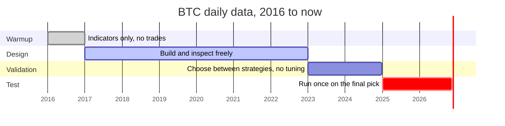
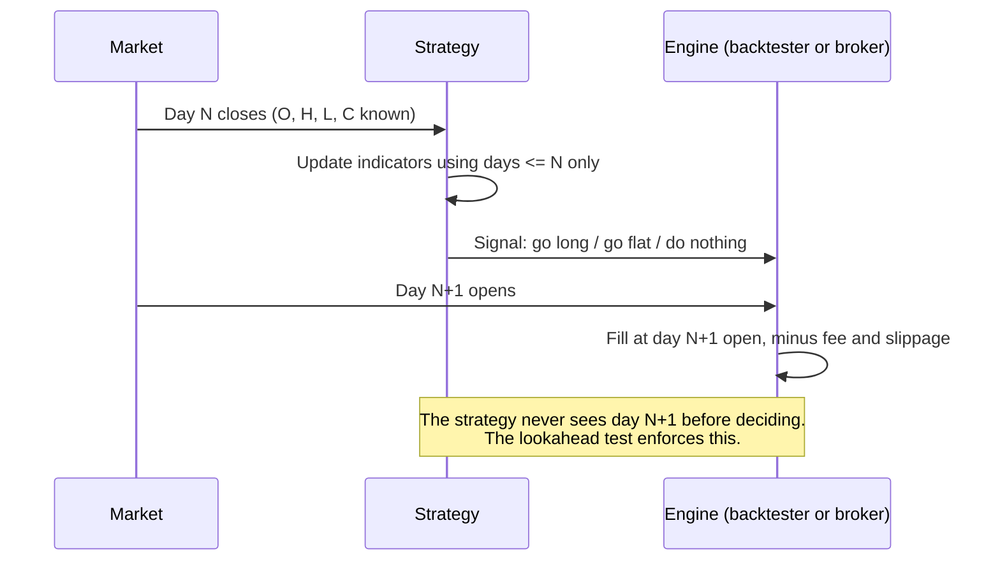

# Architecture

Section 1 is plain text. Sections 2-3 are Mermaid diagrams, which render on GitHub (and in VS Code
with a Mermaid preview extension). Update this file whenever the structure changes.

## 1. Components and data flow

Arrows from left to right show data moving. `^` means "started by".

```
                            config.py                   strategies.py
                            settings                    8 long-only rules
                                |                             |
                                +---------------+-------------+
                                                |
                                                v
 Coinbase API ---> data.py ---> data/ ---> backtest.py ---> results/
 public, no key    fetch +      candles    cut slice +      tables
                   validate     (git-      warmup, run,     (committed)
                                ignored)   metrics
                      ^                         ^
                      |                         |
                fetch_data.py           run_backtests.py
                refresh data            research only
                \_____ research tools, run manually ____/
```

Research tools (manual, never scheduled):
- `fetch_data.py`: refresh data. Run it before a research session.
- `run_backtests.py`: research only. Run it after changing a strategy or a setting in `config.py`.

Other notes:
- `config.py` holds every setting (it also gives `data.py` its file paths).
- `tests/` checks `data.py` (validation) and `backtest.py` (lookahead, warmup, fees, metrics).

**Planned:**

```
 strategies.py ---> live runner ---> Alpaca  (paper first, then $150)
                         ^
                         |
                 daily scheduled job

 backtest.py   ---> walk-forward check       (more honest validation)
 run_final.py  ---> backtest.py on test      (once, final pick only)
```

The live runner will reuse the same strategy classes, so what we paper trade is exactly what
we backtested.

## 2. Data timeline: what each slice is for



Each slice also loads the 250 days *before* it for indicator warmup. That
history is visible to indicators but never traded.

## 3. One day in the life of a strategy


